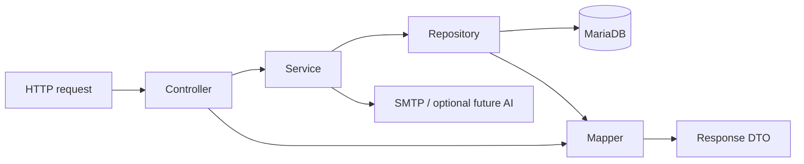

# Architecture

TutorMatch uses React JavaScript → Spring Boot REST API → MariaDB. The current scope is email-only account activation, manual tutor identity review, tutor discovery and trial requests. Phone numbers are contact information shared after acceptance; they are not an activation channel. Current delivery is limited to Sprints 1–4. Discovery uses rules; AI work is deferred and its provider configuration is empty.

## Backend layers

```text
com.tutormatch/
├── controller/       HTTP routes, validation, cookies, response status/headers
├── service/          Use cases, ownership, business rules and transaction boundaries
├── repository/       Parameterized JDBC queries and the retained JPA user repository
├── mapper/           Database rows → domain models; models → explicit response DTOs
├── dto/              Validated request records and response records, grouped by feature
├── model/            Typed account, student, tutor, challenge and document models
├── integration/
│   ├── delivery/     SMTP email delivery
│   └── ai/           LlmRanker boundary and chat-completions HTTP adapter
├── security/         Session authentication filter and opaque-token utilities
├── exception/        BusinessException and centralized API error translation
├── config/           Spring Security and explicit admin/demo bootstrap
└── matching/         Retained standalone cosine utility
```

Controllers call services and mappers. Services depend on repositories, domain models, policies and integration boundaries. Repositories own SQL and use mappers to hydrate typed models. Mappers do not query the database. Business failures are translated to HTTP at the exception boundary. Services and controllers do not expose `JdbcTemplate`, return raw database rows or access another service's database handle.



Student and tutor workflows have separate services and repositories. Trial, swipe, verification and recommendation workflows are also separate. Concrete Spring services/repositories are used directly; interfaces are reserved for interchangeable integrations such as `LlmRanker`.

## Authentication and privacy

Passwords use BCrypt. Opaque session tokens are hashed in MariaDB, expire after eight hours and are sent only in an HttpOnly SameSite=Lax cookie. CSRF uses a cookie/header exchange. Logout revokes the current session; password reset revokes every session. Registration, resend, verification, login and reset are throttled. Verification and reset challenges expire after ten minutes, are single-use and lock after repeated invalid guesses; failed guesses remain counted when validation rolls back.

Only email verification is required to activate an account. `phone_verified` remains an unused legacy database column; new registrations do not claim the phone was verified. Admin accounts are provisioned privately, never through public registration. SMTP settings live in the backend. Local Compose uses Mailpit, whose inbox captures development emails; an external SMTP configuration is required to deliver to real recipients.

Student responses are selected explicitly and returned only to the owning parent. Tutor responses are typed allowlists: owner/admin mapping includes workflow metadata; public mapping excludes owner IDs, submission IDs, rejection details, document metadata and audit. Evidence is served only to admins with attachment/no-store headers. Identity verification is a human decision, not a property inferred from uploading a file.

## Profiles and verification

Parents may manage multiple student profiles. Each save requires consent and records its timestamp. The UI provides six survey questions and free-text needs; the API accepts at most 15 survey entries. Availability uses weekly AM/PM/EVENING slots.

Tutor profile saves and photo changes lock the profile, increase its revision, and withdraw any approval or pending submission back to DRAFT. Rejected profiles retain their reason until resubmission. Evidence can be added, replaced, renamed or deleted; changes withdraw an approval or pending submission. Submission requires a complete profile and evidence. Admin approval requires that admin to have opened evidence for the current submission. Decisions are audited with the submission ID and profile revision and can be inspected in the admin review UI. Existing audit records retain null historical submission/revision values.

Only email-activated, approved, visible tutors can be discovered. Tutor relation hydration uses three batch queries for subjects, grades and teaching modes rather than a separate query per relation per candidate.

## Recommendations and saved interests

Mandatory filters require every requested subject, grade, teaching format, shared weekly slot, budget and the same province for in-person learning. Eligible unseen candidates are ordered deterministically before at most 20 enter AI ranking. The rule score considers shared slots, experience and budget headroom. Up to five validated results are returned by the legacy recommendation route; the matching AI list returns up to ten.

The existing `LlmRanker` boundary is retained for later work. It receives aliases and allowlisted categories, validates output and preserves rule fallback. No AI runtime, model download or live-inference acceptance is part of the current delivery; the application uses deterministic recommendations with empty provider settings.

Swipes persist interest/skip decisions and never imply trial acceptance. Parents can reopen saved interests after refresh and remove them. Saved-interest queries reapply ownership, visibility and current eligibility; an unavailable tutor is not exposed through history.

## Trial requests — retained for a later sprint

Creation, interest and acceptance are separate actions. Requests contain a proposed time and message. A student-row lock plus a MariaDB generated unique pending-pair index prevents concurrent duplicates. A proposed time must be at least one hour ahead and within 90 days. Pending requests expire after seven days or the proposed time, whichever comes first.

Only the owning tutor may accept/reject an unexpired PENDING request. Contact columns are selected only for ACCEPTED requests belonging to that parent/tutor. Expiration is enforced lazily on operations. Status pages refresh through REST; proposed times do not reserve calendar slots.

## Frontend structure

```text
frontend/src/
├── app/          App shell, workspace provider and context
├── hooks/        Workspace access and hash routing
├── pages/        Home, students, discovery, interests, lessons, tutor and admin screens
├── features/     Auth, student/tutor forms, swipe cards, trial and admin review components
├── components/   Shared fields, dialogs, schedules, notices and empty states
├── services/     API/CSRF client and typed client errors
└── lib/          Presentation constants and survey options
```

Hash routes support refresh/back navigation and email verification/reset links. Link secrets are read into form state and removed from the address bar. The workspace clears account-specific data on logout, account changes and session expiry. Async page loads are aborted when their view changes. An immediate action lock prevents repeated submissions before React updates disabled buttons. The UI has Vietnamese labels, loading/empty/error states, accessible native dialogs, responsive CSS and reduced-motion support.

## Database and verification

Flyway owns migrations; V1 and V2 remain unchanged. Hibernate validates the retained user entity. Legacy `trial_requests` and `reviews` are not converted automatically. See [migrations.md](migrations.md).

Backend regression tests use isolated MariaDB. Playwright uses a separate Compose project with a temporary database, local SMTP inbox and a test-only admin. Browser evidence covers Chromium desktop and mobile emulation; it does not establish compatibility with every physical device/browser. See [verification.md](verification.md) for commands and acceptance evidence.
